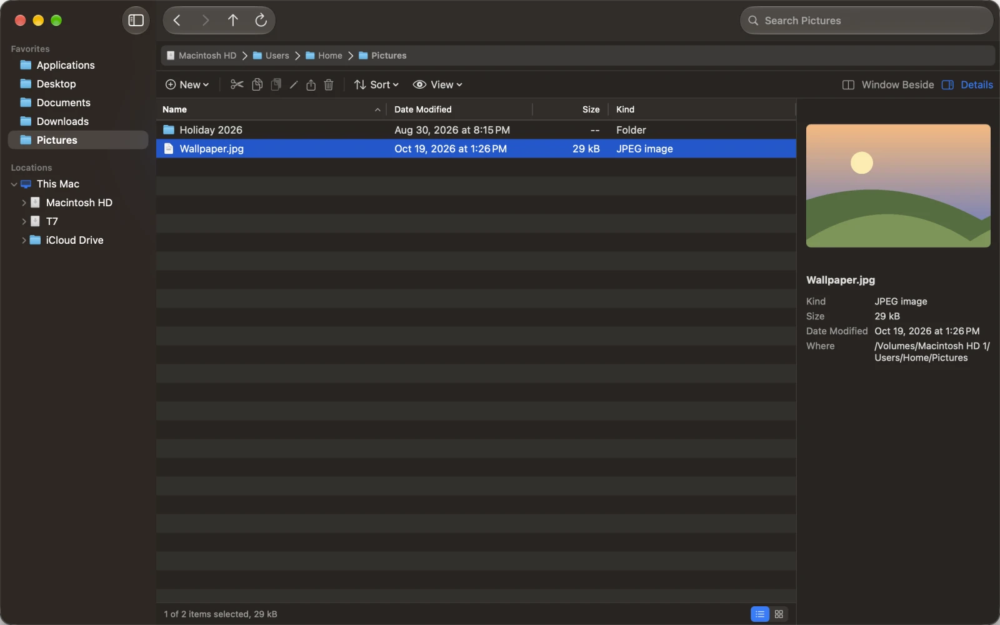
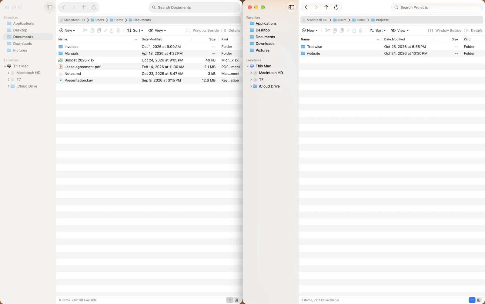
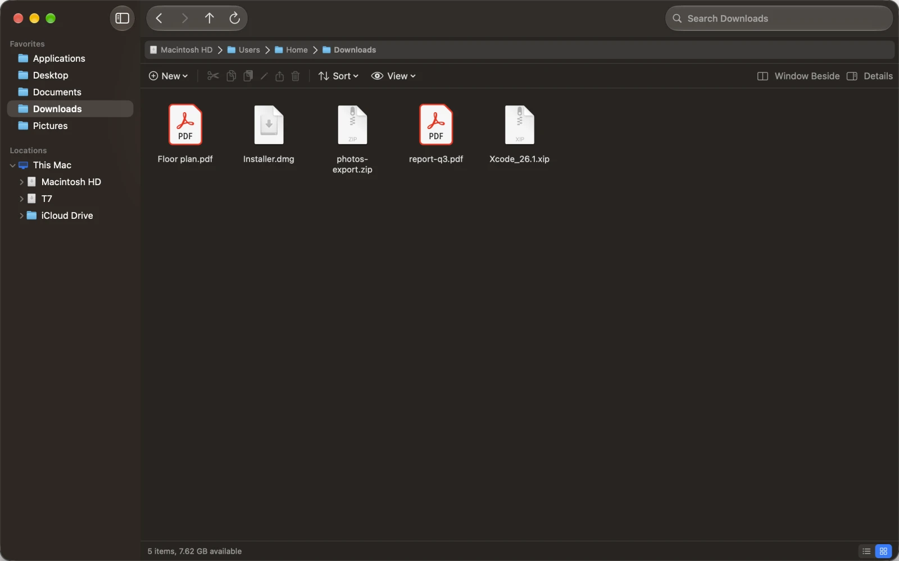

# Treewise

**A file manager for macOS with the behaviour of Windows Explorer and the look of a Mac app.**

Treewise is made for people who learned file management on Windows: a folder tree you can expand to any depth, an address bar and a command bar where Explorer has them, two folders side by side, cut and paste for files, and a clear sign of whether a drag copies or moves. All of it with native Mac controls.



- **A folder tree** in the sidebar: Favorites and every disk, expandable to any depth.
- **An address bar** with the path as buttons, a menu of subfolders behind each arrow, and room to type a path (⌘L).
- **A command bar** as in Explorer: New, Cut, Copy, Paste, Rename, Share and Move to Trash, with Sort and View menus.
- **Two windows side by side** with Window Beside (⌥⌘N): open a folder in the other window, drag between them, or copy and move the selection to the other window.
- **Tabs** as in Finder: ⌘T opens one, a tab tears off into its own window, and every window and tab comes back after a restart.
- **Drag to copy or move,** with a badge that tells you which: on the same disk it moves, to another disk it copies; ⌥ always copies, ⌘ always moves.
- **Cut, copy and paste** files with ⌘X, ⌘C and ⌘V, also between windows and Finder.
- **Undo** (⌘Z) for move, copy, rename, new folder and Move to Trash, in any window.
- **A details pane** with a preview and the kind, size, date and folder of the selection.
- **List and icon view,** Quick Look with Space, renaming with a click on the selected name, live updates, and long copies you can pause, resume and stop.
- **English, Dutch and German,** following your system language.





> Treewise is in beta (version 0.x). It always deletes through the Trash, but keep a backup of anything you cannot lose.

## Install

### With Homebrew

```sh
brew install --cask mag243/tap/treewise
```

### By download

1. Open [**Releases**](https://github.com/mag243/treewise-releases/releases) and download `Treewise-<version>-<build>.dmg` of the newest version.
2. Open it and drag **Treewise** onto **Applications**.
3. Start Treewise from Applications. It is signed and notarized by Apple, so it opens without a warning.

Started from anywhere else, Treewise offers once to move itself into Applications, where it can keep itself up to date.

## Updates

Treewise checks for a new version once a day and asks before it installs one. You can check by hand with **Treewise > Check for Updates…**, and turn the daily check off in **Settings**. A Homebrew install updates the same way; `brew upgrade` leaves it to Treewise.

Every update is signed twice, by Apple's Developer ID and by Treewise's own update key, and is installed only when both check out. Checking for updates sends nothing about you or your Mac; it only reads a list of versions from this site. What changed in each version is on the [Releases](https://github.com/mag243/treewise-releases/releases) page.

## Requirements

- macOS 15 Sequoia or later
- A Mac with Apple silicon or an Intel processor

## Uninstall

Drag Treewise from Applications to the Trash. With Homebrew, `brew uninstall --zap --cask treewise` also removes its settings.

## Feedback

Found a bug or missing something from Explorer? [Open an issue](https://github.com/mag243/treewise-releases/issues).

---

This repository holds the downloads and the update feed of Treewise; it has no source code.
